<picture>
  <source media="(prefers-color-scheme: dark) and (max-width: 600px)" srcset="readme-assets/em-door-dark-narrow.svg">
  <source media="(max-width: 600px)" srcset="readme-assets/em-door-light-narrow.svg">
  <source media="(prefers-color-scheme: dark)" srcset="readme-assets/em-door-dark.svg">
  <source media="(prefers-color-scheme: light)" srcset="readme-assets/em-door-light.svg">
  
</picture>

  <a href="README.md">简体中文</a> · <a href="README.en.md">English</a> · <a href="PERSONAL-NOTICE.md">✦ EricMingle69</a>

I do research and optimisation grounded in human factors engineering. The aim is to free people from burdens they should not have to carry.

I used to work in quality at a factory. The same work had to be written up three times, as a daily, a weekly and a monthly report, and translating an inspection document wrecked its tables. It annoyed me, so I wrote small tools and handed those jobs to the computer.

Since then I have worked in much the same way: look at where people spend more attention, thought, money and time than they should, find out why, change it, then go back to the real world and check. It is not done until it has been checked.

## Air conditioning: leave it on, or cut it off on schedule?

The factory dormitory had a rule: the power was cut the moment working hours began, weekends included, and came back only at rest time. I wanted the rule dropped. Saying it was hot got nowhere, so I had to work it out: which really uses more electricity, leaving it on or cutting it off on schedule?

Honestly, it felt a bit helpless. To get the air conditioning on, I first had to do a study.

<a href="https://github.com/Ming-Sir-69/AC-AlwaysOn-vs-TimerOff-Energy-Comparison">
  <picture>
    <source media="(prefers-color-scheme: dark) and (max-width: 600px)" srcset="readme-assets/cards/ac-energy-dark-mobile.svg">
    <source media="(max-width: 600px)" srcset="readme-assets/cards/ac-energy-light-mobile.svg">
    <source media="(prefers-color-scheme: dark)" srcset="readme-assets/cards/ac-energy-dark.svg">
    
  </picture>
</a>

## Working with AI

I keep changing how I work with AI, and I write down what changes as I go.

I used to have it log every correction I made, hoping to find the shared cause behind the ones I kept repeating. That became Astra Harness. Later I found there was no need to log anything extra: the commits, conversations and review comments are already there, and the causes can be found in those. Once I find one, I change a single thing, then look again a few days later to see whether the mistake comes back.

For example, I recently found that several rounds of rework had the same cause: the task said how to do it, but not who it was for or what was out of scope.

<a href="https://github.com/Ming-Sir-69/astra-harness">
  <picture>
    <source media="(prefers-color-scheme: dark) and (max-width: 600px)" srcset="readme-assets/cards/astra-harness-en-dark-mobile.svg">
    <source media="(max-width: 600px)" srcset="readme-assets/cards/astra-harness-en-light-mobile.svg">
    <source media="(prefers-color-scheme: dark)" srcset="readme-assets/cards/astra-harness-en-dark.svg">
    
  </picture>
</a>

Engram is the knowledge base underneath all this. I do not want to tell an AI the same thing twice.

<a href="https://github.com/Ming-Sir-69/engram">
  <picture>
    <source media="(prefers-color-scheme: dark) and (max-width: 600px)" srcset="readme-assets/cards/engram-en-dark-mobile.svg">
    <source media="(max-width: 600px)" srcset="readme-assets/cards/engram-en-light-mobile.svg">
    <source media="(prefers-color-scheme: dark)" srcset="readme-assets/cards/engram-en-dark.svg">
    
  </picture>
</a>

All of these tools need updating, so I wrote one update module for them, upall: it checks first, and updates only when you press the key.

<a href="https://github.com/Ming-Sir-69/upall">
  <picture>
    <source media="(prefers-color-scheme: dark) and (max-width: 600px)" srcset="readme-assets/cards/upall-en-dark-mobile.svg">
    <source media="(max-width: 600px)" srcset="readme-assets/cards/upall-en-light-mobile.svg">
    <source media="(prefers-color-scheme: dark)" srcset="readme-assets/cards/upall-en-dark.svg">
    
  </picture>
</a>

## Earlier

Course projects and my graduation project, all of which I took seriously at the time: human-factors optimisation of a suitcase (graduation project), a soap dish, production-line simulation, and some 3D modelling practice.

<a href="https://github.com/Ming-Sir-69/Ming-Sir-69-Human-Factors-Simulation-System-for-Graduation-Project">
  <picture>
    <source media="(prefers-color-scheme: dark) and (max-width: 600px)" srcset="readme-assets/cards/human-factors-dark-mobile.svg">
    <source media="(max-width: 600px)" srcset="readme-assets/cards/human-factors-light-mobile.svg">
    <source media="(prefers-color-scheme: dark)" srcset="readme-assets/cards/human-factors-dark.svg">
    
  </picture>
</a>

<a href="https://github.com/Ming-Sir-69/shapr3D-modeling">
  <picture>
    <source media="(prefers-color-scheme: dark) and (max-width: 600px)" srcset="readme-assets/cards/3d-modeling-dark-mobile.svg">
    <source media="(max-width: 600px)" srcset="readme-assets/cards/3d-modeling-light-mobile.svg">
    <source media="(prefers-color-scheme: dark)" srcset="readme-assets/cards/3d-modeling-dark.svg">
    
  </picture>
</a>

## Get in touch

Happy to talk about human factors, quality, small tools for the factory floor, or how to work with AI. For project questions, please open an Issue or Pull Request in the relevant repository.

Stay curious, check things by hand, and keep being a happy pirate. 🏴‍☠️

---

Documentation maintained by **✦ EricMingle69** · [Ming-Sir-69](https://github.com/Ming-Sir-69)  
[Personal identity, licensing and permissions](PERSONAL-NOTICE.md) · The header switches between the light and dark themes.
