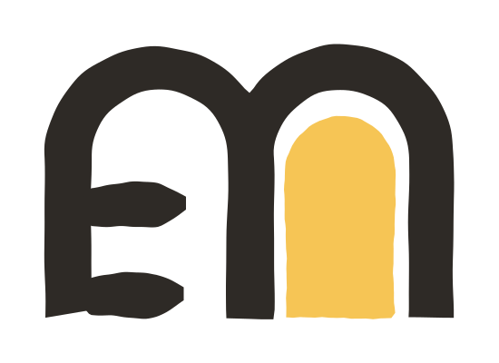

<picture>
  <source media="(prefers-color-scheme: dark) and (max-width: 600px)" srcset="readme-assets/em-door-dark-narrow.svg">
  <source media="(max-width: 600px)" srcset="readme-assets/em-door-light-narrow.svg">
  <source media="(prefers-color-scheme: dark)" srcset="readme-assets/em-door-dark.svg">
  <source media="(prefers-color-scheme: light)" srcset="readme-assets/em-door-light.svg">
  
</picture>

  <a href="README.md">简体中文</a> · <a href="README.en.md">English</a> · <a href="PERSONAL-NOTICE.md"><picture><source media="(prefers-color-scheme: dark)" srcset="readme-assets/em-logo-dark.svg"></picture> EricMingle69</a>

基于人因工程做研究和优化，想把人从不必要的负担里解放出来。

我在工厂做过质量。同一份工作要写成日报、周报、月报三遍，检验文件一翻译表格就乱。嫌烦，就自己写了小工具，把这些交给电脑。

后来做什么都差不多是这个路子：看人在哪里多花了注意力、脑力、钱和时间，弄清楚为什么，改掉，再回到现实里验一遍。验过了才算做完。

## 01　空调能不能提前开，周末还要强制断电吗？

厂区宿舍有条规定：一到上班时间就断电，周六周日也一样，到了休息时间才能再开。我想让他们取消这条规定。光说热没人听，只好去算：按上下班提前开机预冷、周末不断电，比到点强制断电到底多用多少电。

说实话挺无奈的。想吹上空调，得先做一个研究。

<a href="https://github.com/Ming-Sir-69/AC-AlwaysOn-vs-TimerOff-Energy-Comparison">
  <picture>
    <source media="(prefers-color-scheme: dark) and (max-width: 600px)" srcset="readme-assets/cards/ac-energy-dark-mobile.svg">
    <source media="(max-width: 600px)" srcset="readme-assets/cards/ac-energy-light-mobile.svg">
    <source media="(prefers-color-scheme: dark)" srcset="readme-assets/cards/ac-energy-dark.svg">
    
  </picture>
</a>

## 02　和 AI 一起干活

我一直在改自己和 AI 协作的方式，改到哪写到哪。

**02.1**　以前我让它把我的每次纠正都记下来，想找出反复纠正背后的共同原因，做成了 Astra Harness。后来发现不用另外记，提交、对话、评审意见本来就留着，直接从这些里面找就行。找到以后一次只改一处，过几天回头看还犯不犯。

比如最近发现，好几次返工是同一个原因：任务只写了怎么做，没写给谁用、不做什么。

<a href="https://github.com/Ming-Sir-69/astra-harness">
  <picture>
    <source media="(prefers-color-scheme: dark) and (max-width: 600px)" srcset="readme-assets/cards/astra-harness-dark-mobile.svg">
    <source media="(max-width: 600px)" srcset="readme-assets/cards/astra-harness-light-mobile.svg">
    <source media="(prefers-color-scheme: dark)" srcset="readme-assets/cards/astra-harness-dark.svg">
    
  </picture>
</a>

&nbsp;

**02.2**　Engram 是这套做法底下的知识库。同一件事，我不想对 AI 交代第二遍。

<a href="https://github.com/Ming-Sir-69/engram">
  <picture>
    <source media="(prefers-color-scheme: dark) and (max-width: 600px)" srcset="readme-assets/cards/engram-dark-mobile.svg">
    <source media="(max-width: 600px)" srcset="readme-assets/cards/engram-light-mobile.svg">
    <source media="(prefers-color-scheme: dark)" srcset="readme-assets/cards/engram-dark.svg">
    
  </picture>
</a>

&nbsp;

**02.3**　这些工具都要更新，我给它们写了一个统一的更新模块 upall：先检查，再更新，要不要更新由你按下决定。

<a href="https://github.com/Ming-Sir-69/upall">
  <picture>
    <source media="(prefers-color-scheme: dark) and (max-width: 600px)" srcset="readme-assets/cards/upall-dark-mobile.svg">
    <source media="(max-width: 600px)" srcset="readme-assets/cards/upall-light-mobile.svg">
    <source media="(prefers-color-scheme: dark)" srcset="readme-assets/cards/upall-dark.svg">
    
  </picture>
</a>

## 03　更早

课程设计和毕业设计，当时都是当真做的。

**03.1**　毕业设计

<a href="https://github.com/Ming-Sir-69/Ming-Sir-69-Human-Factors-Simulation-System-for-Graduation-Project">
  <picture>
    <source media="(prefers-color-scheme: dark) and (max-width: 600px)" srcset="readme-assets/cards/human-factors-dark-mobile.svg">
    <source media="(max-width: 600px)" srcset="readme-assets/cards/human-factors-light-mobile.svg">
    <source media="(prefers-color-scheme: dark)" srcset="readme-assets/cards/human-factors-dark.svg">
    
  </picture>
</a>

&nbsp;

**03.2**　课程设计与建模

<a href="https://github.com/Ming-Sir-69/Human-Factors-Engineering-Project">
  <picture>
    <source media="(prefers-color-scheme: dark) and (max-width: 600px)" srcset="readme-assets/cards/3d-modeling-dark-mobile.svg">
    <source media="(max-width: 600px)" srcset="readme-assets/cards/3d-modeling-light-mobile.svg">
    <source media="(prefers-color-scheme: dark)" srcset="readme-assets/cards/3d-modeling-dark.svg">
    
  </picture>
</a>

## 交流

想聊人因、质量、工厂里的小工具，或者怎么和 AI 一起干活，都欢迎。项目问题请到对应仓库提 Issue 或 Pull Request。

保持好奇，动手验证，上了生活的贼船，就做快乐的海盗。🏴‍☠️

---

文档维护：<picture><source media="(prefers-color-scheme: dark)" srcset="readme-assets/em-logo-dark.svg"></picture> <b>EricMingle69</b> · <a href="https://github.com/Ming-Sir-69">Ming-Sir-69</a> 
[个人标识、许可与权限说明](PERSONAL-NOTICE.md) 
